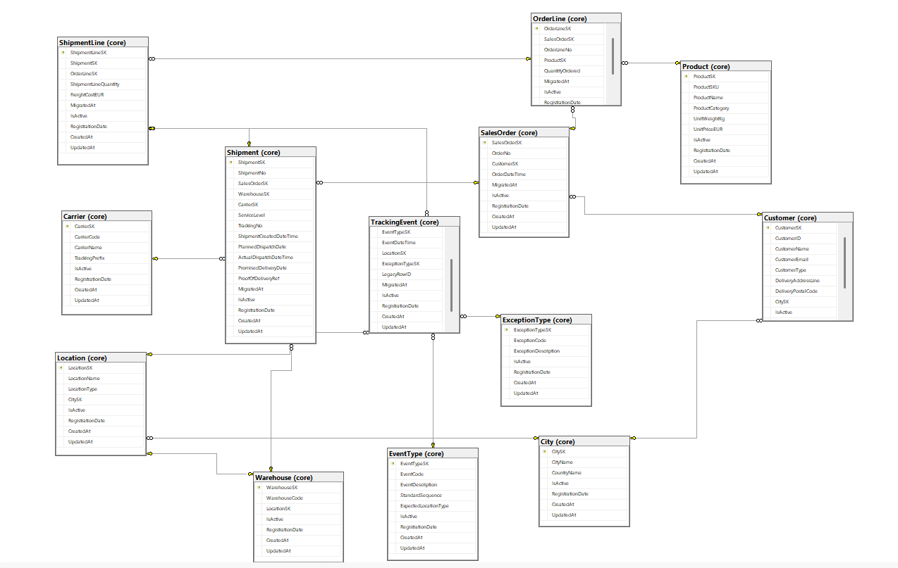

# Operation RouteGlass: Order-to-Delivery Database Migration (SQL Server)

> [!NOTE] 
> Sorellin Living B.V. does not exist. Every customer, warehouse, carrier, and shipment in this repository is simulated: fictional names attached to simulated data, built to simulate a real legacy-migration problem for this fictional organization. Any resemblance to any business name, company or organization is entirely and purely coincidental. The data isn't real, but the work is. Every figure here comes from my own SQL against that dataset, and every row is reconciled back to the source. Think of it as a test track for logistics analytics: the parcels never moved, but the engine is real.


> *I migrated an 18,000-row legacy delivery extract into a 13-table, 3NF SQL Server database, accounted for every source row, and showed why the legacy report overstated freight cost six times (€243,578 instead of €40,249). Sorellin needs that fixed before it renegotiates its carrier contracts.*



**Project type:** End-to-end SQL migration: data profiling, data cleaning, 3NF data modelling, ETL, reconciliation and SQL analysis.

---

## Table of Contents
1. [Project Overview](#1-project-overview)
2. [Objectives](#2-objectives)
3. [Project Scope & Tools](#3-project-scope--tools)
4. [Repository Structure](#4-repository-structure)
5. [Data Workflow](#5-data-workflow)
6. [Data Model & Schema](#6-data-model--schema)
7. [Entity Relationship Diagram (ERD)](#7-entity-relationship-diagram-erd)
8. [Analysis & Metrics](#8-analysis--metrics)
9. [Key Insights](#9-key-insights)
10. [Recommendations](#10-recommendations)
11. [Assumptions & Limitations](#11-assumptions--limitations)
12. [Future Enhancements](#12-future-enhancements)
13. [Deliverables](#13-deliverables)
14. [Author](#14-author)

---

## 1. Project Overview

**Context:** Sorellin Living B.V. ships homeware and small furniture from 4 European fulfilment centres through 6 parcel and freight carriers, to customers in the Benelux, Germany, France, Luxembourg and Austria. Late-delivery complaints were rising, and the company planned to renegotiate its carrier contracts. All of its order, warehouse and tracking data sat in one wide, 50-column customer-service extract. *(Data With Danny, Cohort 9, Group 3. A training case: the company and all records are fictional.)*

**Problem Statement:** Operations could not reliably reconstruct the journey of a single shipment. Split shipments, repeated scans, missing milestones and inconsistent carrier names made the legacy report impossible to reconcile. Leadership's question was: *can Sorellin replace the legacy visibility report with a relational database that reconstructs any order's journey and holds warehouses and carriers accountable?*

**Approach:** I profiled the extract to find its grain and its quality issues, designed a 3NF model, and built 9 numbered, rerunnable T-SQL scripts. They load the untouched CSV into staging, clean and log every change, migrate the data into 13 tables, add constraints, and prove the result reconciles to the source.

**Outcome:** Every one of the 18,000 source rows is accounted for (18,000 − 140 duplicates − 64 repeated scans = 17,796 events), and all business totals match. The rebuilt data showed that **71% of late deliveries left the warehouse late**, so carriers are not the only problem. The recommendation is a **conditional go**.

---

## 2. Objectives

- **Primary Objective:** Determine whether the legacy extract can be migrated into a 3NF SQL Server database that reconstructs any order's journey, end to end, with every source row accounted for.
- **Secondary Objective 1:** Establish the source grain and classify every data quality issue as a defect, a source-system rule, legitimate repetition or a correct blank.
- **Secondary Objective 2:** Prove completeness, uniqueness, referential integrity and agreement of business totals (quantity, order value, freight, alerts) between source and target.
- **Secondary Objective 3:** Quantify late-delivery performance by carrier, service level and warehouse, so leadership has evidence for the carrier negotiation.

> 💡 *Every analysis decision in this project traces back to one of these objectives.*

---

## 3. Project Scope & Tools

### Scope

| Dimension | Details |
|-----------|---------|
| **In Scope** | The full legacy extract (18,000 rows, 50 columns): orders, order lines, customers, products, warehouses, shipments, carriers and tracking events. Covers profiling, 3NF design, staging, migration, constraints, reconciliation and 12 business queries. |
| **Out of Scope** | **Sales channel:** it changes within 1,507 of 1,509 orders, so there was no reliable value to migrate. It stays in staging and is logged. **Order status:** not stored, because it can be derived from the latest tracking event. **Currency:** always EUR, so it's held in the column names instead. Customer complaint data was not supplied, so complaints could not be linked to lateness. |
| **Time Period** | January to December 2025 (4 orders fall on 1–2 January 2026; they were kept and flagged) |
| **Granularity** | Source: one row = one tracking event for one shipment line. Analysis: delivered shipment line (2,973 lines) for lateness; shipment (1,689) for dispatch performance. |

### Tools & Technologies

| Category | Tool(s) Used |
|----------|-------------|
| Data Storage | Microsoft SQL Server (`SorellinLivingDB`, with `stg`, `map`, `audit` and `core` schemas) |
| Data Processing | T-SQL: `BULK INSERT`, `TRY_CONVERT`, mapping tables, guarded scripts |
| Analysis | T-SQL: joins, CTEs, views, window functions (`LAG`, `ROW_NUMBER`, `RANK`, rolling `SUM`) |
| Version Control | Git / GitHub |
| Documentation | Markdown, migration report (PDF) |

---

## 4. Repository Structure

```
operation-routeglass/
│
├── data/
│   └── raw/
│       ├── 02_Sorellin_Legacy_Order_Delivery_Extract.csv   # Untouched source; SHA-256 recorded before load
│       └── 03_Source_Data_Dictionary.csv                   # Field definitions supplied with the case
│
├── sql/
│   ├── 01_create_database.sql              # Database and schemas
│   ├── 02_create_staging.sql               # Raw staging table (all text, no constraints)
│   ├── 03_bulk_insert.sql                  # Loads the CSV as-is
│   ├── 04_profile_and_clean.sql            # Profiling, mapping tables, exception log, cleaning
│   ├── 05_create_3nf_schema.sql            # 13 core tables
│   ├── 06_migrate_data.sql                 # Parents first, then children
│   ├── 07_constraints_and_indexes.sql      # PK, UNIQUE, FK, CHECK and indexes, added after load
│   ├── 08_validation_and_reconciliation.sql
│   └── 09_business_queries.sql             # 12 business queries
│
├── visuals/
│   ├── ERD 1.png
│   ├── ERD 2.png
│
├── docs/
│   ├── Migration_Report.pdf
│   └── Presentation.pptx
│
└── README.md
```

**How to run:** Update the file path in `03_bulk_insert.sql`, then run scripts **01 → 09 in order** in SSMS or Azure Data Studio. To rerun the migration, run `05` (it empties the core tables), then `06` and `07`.

---

## 5. Data Workflow

```
Legacy CSV (untouched, checksum recorded)
      ↓
BULK INSERT → stg.Legacy_Extract_Raw (all text)
      ↓
Profile → map tables → clean → audit.Exception_Log
      ↓
Migrate into 13 core 3NF tables → add constraints
      ↓
Reconcile source vs target → 12 business queries → report + presentation
```

1. **Source:** One CSV export from the legacy customer-service system: 18,000 rows, 50 columns, about 9.5 MB, UTF-8 with BOM. It came with a source data dictionary. The file was never edited by hand. Its row count and SHA-256 checksum were recorded before loading.
2. **Ingestion:** `BULK INSERT` (`FORMAT = 'CSV'`, `CODEPAGE = '65001'`, `FIRSTROW = 2`) into `stg.Legacy_Extract_Raw`. Every column was loaded as text, so no value could be rejected or changed during the load. The raw table is never modified afterwards.
3. **Cleaning:** Every change is written to `audit.Exception_Log` with a rule code, its action (Rejected, Standardised, Excluded or Flagged), and the source and clean values.

   | Issue | Count | Handling |
   |---|---|---|
   | Exact duplicate rows | 140 | Rejected, one copy kept |
   | Repeated scans (same line, event, time and place; new event ID) | 64 | Lowest event ID kept, others rejected |
   | Comma decimals (`"12,48"`) | 622 values | `REPLACE` + `TRY_CONVERT` |
   | Carrier name spelled 4 ways (C01) | 71 rows | Mapped to one name by carrier code |
   | Country alias `NL` | 71 rows | Mapped to `Netherlands` |
   | "Rotterdam Gateway" stored as a city | 2,330 rows | City taken from a location master |
   | Hub country recorded inconsistently | 8,911 events | Country taken from a location master |
   | Sales channel changes inside one order | 1,507 orders | Excluded. No reliable value, so no guess |
   | Missing `HUB_OUT` scans | 46 lines | Kept and flagged. No scans invented |
   | Line still in transit | 1 line (2 milestones) | Kept. Blanks are correct |
   | Out-of-sequence timestamps | 613 events | Kept and flagged |
   | Postal codes not in national format | 657 customers | Kept as supplied and flagged |
   | Orders outside Jan–Dec 2025 | 4 orders | Kept and flagged |

   Guard checks stop the script if any value fails to map or convert, so nothing moves forward silently.
4. **Transformation:** Normalised the clean extract into 13 tables, using the functional dependencies confirmed in profiling (for example `Shipment_No → order, warehouse, carrier, service level, dates`). Each table gets an `IDENTITY` surrogate key. The business key is kept and made `UNIQUE`. The migration loads parents before children, looks up surrogates by business key, and **stops itself if the target already holds data**, so rows can never be doubled. Constraints are added **after** the load: 13 primary keys, 24 unique keys, 15 foreign keys and 27 CHECK constraints.
5. **Analysis:** Reconciliation of source against target values (control totals, entity counts, orphans, duplicate keys, business totals), then 12 business queries covering journey reconstruction, carrier and warehouse performance, scan quality, freight, trend and a sensitivity check.
6. **Output:** A rerunnable SQL pipeline, an audited 3NF database, an ERD, a migration report and a presentation with a go/no-go recommendation.

---

## 6. Data Model & Schema

### Source: `stg.Legacy_Extract_Raw`
A single wide extract of **50 columns** that mixes order, customer, product, warehouse, shipment, carrier and tracking fields on every row. Because each row is one tracking event, order and shipment attributes repeat on every scan. That repetition is why summing freight straight from the file overstates it about six times.

### Target: 13 tables in schema `core`

| Table | One row per | Business key | Rows |
|---|---|---|---|
| `City` | City and country | `CityName` + `CountryName` | 21 |
| `Customer` | Customer | `CustomerID` | 972 |
| `Product` | Product | `ProductSKU` | 72 |
| `Location` | Scan point (4 warehouses + 5 hubs) | `LocationName` | 9 |
| `Warehouse` | Fulfilment centre (subtype of Location) | `WarehouseCode` | 4 |
| `Carrier` | Carrier | `CarrierCode` | 6 |
| `Event_Type` | Tracking milestone (PICKED → DELIVERED) | `EventCode` | 6 |
| `Exception_Type` | Legacy alert (LATE, SCAN_GAP) | `ExceptionCode` | 2 |
| `Sales_Order` | Order | `OrderNo` | 1,509 |
| `Order_Line` | Product line in an order | `SalesOrderSK` + `OrderLineNo` | 2,974 |
| `Shipment` | Shipment (an order can have several) | `ShipmentNo` | 1,689 |
| `Shipment_Line` | Order line in a shipment (bridge) | `ShipmentSK` + `OrderLineSK` | 2,974 |
| `Tracking_Event` | Scan of one shipment line | `TrackingEventID` | 17,796 |

Every table also carries `IsActive`, `CreatedAt` and `UpdatedAt`. Transaction tables also carry `MigratedAt` for lineage.

### Key tables in detail

**`core.Shipment`**

| Field Name | Data Type | Description | Example Value |
|------------|-----------|-------------|---------------|
| `ShipmentSK` | int (identity) | Surrogate primary key | 2 |
| `ShipmentNo` | varchar(20) | Business key | SHP-0000002-1 |
| `SalesOrderSK` | int | FK → `Sales_Order` | 2 |
| `WarehouseSK` / `CarrierSK` | smallint | FK → `Warehouse` / `Carrier` | 3 |
| `ServiceLevel` | varchar(10) | Standard, Economy or Priority | Priority |
| `TrackingNo` | varchar(30) | Carrier tracking number (unique) | NRLG… |
| `PlannedDispatchDate` | date | Date the warehouse should dispatch | 2025-03-14 |
| `ActualDispatchDateTime` | datetime2 | NULL until dispatched | 2025-03-15 09:42 |
| `PromisedDeliveryDate` | date | Date promised to the customer | 2025-03-18 |
| `ProofOfDeliveryRef` | varchar(20) | NULL until delivered | POD-… |

**`core.Shipment_Line`**: the bridge between `Shipment` and `Order_Line`

| Field Name | Data Type | Description | Example Value |
|------------|-----------|-------------|---------------|
| `ShipmentLineSK` | int (identity) | Surrogate primary key | 5 |
| `ShipmentSK` | int | FK → `Shipment` | 2 |
| `OrderLineSK` | int | FK → `Order_Line` | 4 |
| `ShipmentLineQuantity` | smallint | Units shipped on this line | 2 |
| `FreightCostEUR` | decimal(10,2) | Freight at its true grain | 12.48 |

**`core.Tracking_Event`**

| Field Name | Data Type | Description | Example Value |
|------------|-----------|-------------|---------------|
| `TrackingEventSK` | int (identity) | Surrogate primary key | 5086 |
| `TrackingEventID` | varchar(20) | Source event ID (unique) | EVT-000005086 |
| `ShipmentLineSK` | int | FK → `Shipment_Line` | 851 |
| `EventTypeSK` | tinyint | FK → `Event_Type` | 4 |
| `EventDateTime` | datetime2 | When the scan happened | 2025-06-02 17:10 |
| `LocationSK` | smallint | FK → `Location` | 6 |
| `ExceptionTypeSK` | tinyint | FK → `Exception_Type`; NULL = no alert | NULL |
| `LegacyRowID` | varchar(20) | Traces the event to its source row (unique) | SCL-00005086 |

> **Row count:** 18,000 source rows → 17,796 tracking events
> **Date range:** January – December 2025 (plus 4 orders on 1–2 Jan 2026)
> **Key join path:** `Tracking_Event → Shipment_Line → Shipment → Sales_Order → Customer`

**Key design decisions**
- **Events attach to the shipment line, not the shipment.** In the source, two lines in the same parcel were scanned at different times and hubs.
- **Freight lives on `Shipment_Line`**, the only grain at which it is unique.
- **Order status is derived, not stored.** It comes from the latest tracking event, so there is one version of the truth.
- **Hub city and country come from `Location → City`**, never from the unreliable source columns.
- **A surrogate key plus a UNIQUE business key on every table.** An identity column can't detect duplicates; the unique business key can, and it is still the value people search by.

---

## 7. Entity Relationship Diagram (ERD)


> ***13 tables fully captured***

**Table Relationships Summary** (15 foreign keys)

| Relationship | Join Key | Type |
|-------------|----------|------|
| `Customer` → `City` | `CitySK` | Many-to-One |
| `Location` → `City` | `CitySK` | Many-to-One |
| `Warehouse` → `Location` | `LocationSK` | One-to-One |
| `Sales_Order` → `Customer` | `CustomerSK` | Many-to-One |
| `Order_Line` → `Sales_Order` | `SalesOrderSK` | Many-to-One |
| `Order_Line` → `Product` | `ProductSK` | Many-to-One |
| `Shipment` → `Sales_Order` | `SalesOrderSK` | Many-to-One (split shipments) |
| `Shipment` → `Warehouse` | `WarehouseSK` | Many-to-One |
| `Shipment` → `Carrier` | `CarrierSK` | Many-to-One |
| `Shipment_Line` → `Shipment` | `ShipmentSK` | Many-to-One |
| `Shipment_Line` → `Order_Line` | `OrderLineSK` | Many-to-One |
| `Tracking_Event` → `Shipment_Line` | `ShipmentLineSK` | Many-to-One |
| `Tracking_Event` → `Event_Type` | `EventTypeSK` | Many-to-One |
| `Tracking_Event` → `Location` | `LocationSK` | Many-to-One |
| `Tracking_Event` → `Exception_Type` | `ExceptionTypeSK` | Many-to-One |

---

## 8. Analysis & Metrics

### Analytical Approach

The work had two stages. The first was **verification**: prove that the migrated database is complete and trustworthy, by comparing a source value with a target value for every check. The second was **diagnosis**: use the trusted data to test where late deliveries come from (warehouse, carrier, service level or hub), and whether lateness is really rising. A sensitivity check confirms that the carrier results hold once lines with timestamp conflicts are removed. "Late" is defined once, in a shared view, so every query uses the same rule.

### Key Metrics Defined

| Metric | Plain-Language Definition | Why It Matters |
|--------|--------------------------|----------------|
| `Control total` | Source rows minus rejected duplicates and repeated scans, compared with the events in the target | Proves no row was lost or invented |
| `Late delivery rate` | Delivered shipment lines whose delivery date is after the promised date, as a share of all delivered lines | Core carrier accountability measure. It matches all 843 legacy LATE alerts |
| `Late dispatch rate` | Shipments that left the warehouse after their planned dispatch date, as a share of all shipments | Separates the warehouse's part of the journey from the carrier's |
| `Freight cost` | Freight summed once per shipment line, not per scan row | Corrects the six-fold overstatement in the legacy report |
| `Freight per kg` | Freight cost divided by shipped weight (quantity × unit weight), per carrier | Compares carrier cost on a like-for-like basis |
| `Hub dwell time` | Hours between `HUB_IN` and `HUB_OUT` for lines with both scans in the right order | Tests whether hubs are a bottleneck |
| `Out-of-sequence rate` | Events timed earlier than the milestone before them, as a share of a carrier's events | Measures how far a carrier's scan records can be trusted |
| `Rolling 3-month late rate` | Late lines divided by delivered lines over the current and two previous months | Tests whether lateness is actually rising |

### Methods Used

- Profiling queries: distinct counts, blanks per column (`UNPIVOT`), type-conversion checks, case-sensitive variant detection
- Functional dependency checks to justify each table split (one name per code, one country per location, and so on)
- Deduplication with `ROW_NUMBER()` over business keys; standardisation through mapping tables
- Chronology checks with `LAG()` to find out-of-sequence events and missing milestones
- Source-vs-target reconciliation: counts, orphan checks, duplicate-key checks, business totals
- Segmentation by carrier, service level, warehouse and hub; ranking with `RANK()`
- Trend analysis with a rolling 3-month window (`SUM() OVER … ROWS BETWEEN 2 PRECEDING AND CURRENT ROW`)
- Sensitivity analysis: carrier late rates recalculated without the 609 lines that have timestamp conflicts

---

## 9. Key Insights

### **Insight 1: The legacy report overstated freight six times**<br>
Freight is repeated on every tracking-event row, so summing it straight from the file gives €243,578.01. Summed once per shipment line, it is €40,249.18. Any carrier cost comparison built on the old report would have started from the wrong number. This is a grain problem, not a data entry problem.

### **Insight 2: Most late deliveries started at the warehouse**<br>
Of the 843 late lines, 598 (71%) were dispatched late, and only 245 left on time and were then delayed by the carrier. Lille has the weakest dispatch record: 57.3% of its shipments left late, against 46–48% at the other three warehouses. A carrier negotiation that ignores dispatch would target the smaller part of the problem. *(This shows where delays began, not their full cause.)*

### **Insight 3: Priority service is the least reliable, at every carrier**<br>
Priority has the highest late rate at all 6 carriers (37–58%). Customers paying for faster delivery are the most likely to receive it late. That points to promised lead times that the network cannot meet, not to one bad carrier.

### **Insight 4: The carrier ranking is robust, and one carrier has a scanning gap**<br>
NordRoute has the highest late rate (35.86%) and Alpina the lowest (22.08%). Without the 609 lines that have timestamp conflicts, the ranking is unchanged (36.67% and 20.62%), so the result can be used in the negotiation. All 46 missing `HUB_OUT` scans belong to NordRoute at Liège Hub. That is a specific, fixable data-quality obligation.

### **Insight 5: Hubs are not the bottleneck**<br>
Every hub averages about 14 hours between `HUB_IN` and `HUB_OUT`. With dwell time this even, hub handling does not explain the differences between carriers or warehouses.

### **Insight 6: Lateness is not rising, even though complaints are**<br>
The rolling 3-month late rate fell from 34.21% (February 2025) to 26.47% (December 2025). If complaints rose anyway, something other than delivery lateness (such as service expectations or communication) is likely driving them. That needs data this extract doesn't hold.

---

## 10. Recommendations

**Decision: Conditional go.** The database does what leadership asked: any order can be traced end to end, and every row reconciles. Go live on the conditions below.

| Priority | Recommendation | Based On | Suggested Owner |
|----------|---------------|----------|-----------------|
| High | Bring warehouse dispatch into the carrier negotiation story, and start a dispatch review at Lille (57.3% late dispatch) before blaming carriers for the full delay | Insight 2 | Head of Fulfilment / Operations |
| High | Require NordRoute to fix its missing `HUB_OUT` scans at Liège Hub as a contract condition, with a scan-completeness target | Insight 4 | Carrier Management / Procurement |
| High | Retire the legacy report's freight figure and report freight only from `Shipment_Line` | Insight 1 | Finance / BI team |
| Medium | Review promised lead times for Priority service with each carrier, since all 6 miss it most often | Insight 3 | Commercial / Carrier Management |
| Medium | Investigate the 613 out-of-sequence timestamps with the carriers, to find whether scanners or clocks are at fault | Insight 4, reconciliation | Carrier Management with IT |
| Medium | Source sales channel from the order system, not the delivery extract, and add it to `Sales_Order` | Scope exclusion | Data / IT team |
| Low | Analyse complaint data against delivery performance, to find what is driving complaints if not lateness | Insight 6 | Customer Service with Data team |

---

## 11. Assumptions & Limitations

### Assumptions
- The extract was treated as the complete record for 2025. It was not checked against record counts in the source systems.
- Hub city and country were taken from the real location of each hub (a location master). The source country column was unreliable: each hub appeared with all four countries.
- Where scans were repeated (same line, event, time and location), the lowest event ID was kept as the genuine scan.
- "Late" means the delivery date is after the promised date, compared at day level. This matches 100% of the legacy on-time flags and LATE alerts.
- The 4 orders dated 1–2 January 2026 were kept, because excluding them is a scope decision for the business.

### Limitations
- **No sales channel analysis.** The channel changes within almost every order, so it couldn't be migrated or analysed.
- **Cause vs. location of delay.** Late dispatch shows where a delay began, not why. A late dispatch can still be followed by a slow carrier leg.
- **Line-level weighting.** Late rates are counted per delivered shipment line, so shipments with more lines carry more weight. Dispatch rates are counted per shipment.
- **Unresolved timestamps.** 613 events are timed earlier than the milestone before them. They were kept and flagged, not corrected, so time-between-milestone measures exclude them.
- **Unverifiable fields.** 657 customers have postal codes that don't match national formats. They were kept as supplied, because there was no reference data to correct them.
- **No complaint data.** The rise in complaints couldn't be linked directly to delivery performance.
- **Training data.** The case is fictional and covers one year, so seasonality can't be tested across years.

> *The goal here is pre-emptive Q&A. What would a thoughtful skeptic push back on? Document the answer here, before they ask.*

---

## 12. Deliverables

| Deliverable | Description | Location |
|-------------|-------------|----------|
| SQL pipeline | 9 numbered, rerunnable scripts: database, staging, load, profiling and cleaning, schema, migration, constraints, reconciliation, business queries | [`/sql_scripts`]([sql/](https://github.com/anuhimustee/SorellinLiving-Order-to-Delivery-Database-Migration-SQL-Server-/tree/main/sql_scripts)) |
| ERD | 13-table 3NF model with keys and cardinalities (image + DBML) | [`/visuals`]([erd/](https://github.com/anuhimustee/SorellinLiving-Order-to-Delivery-Database-Migration-SQL-Server-/blob/main/visuals/ERD%201.png)) |
| Exception log | Every rejected, standardised, excluded or flagged value, with its rule code | `audit.Exception_Log` (built by script 04) |
| Migration report | Profiling findings, design decisions, reconciliation results and go/no-go recommendation |  [`/docs/SorellingLivingMigrationDocument`](https://github.com/anuhimustee/SorellinLiving-Order-to-Delivery-Database-Migration-SQL-Server-/blob/main/docs/SorellinLiving%20MigrationDocumentGithub.pdf) |


---

## 14. Author

**Sir Mustee**<br>
Data Analyst • Logistics Analyst • Supply Chain Analyst

- 🔗[LinkedIn](https://www.linkedin.com/in/anuhi-mustapha/)
- 💼[Medium Article link](https://medium.com/@helloanuhi/sorellin-was-about-to-blame-its-carriers-18-000-rows-of-data-said-check-your-own-warehouse-first-e8ea70d65e3e)

---

> ***Last updated: Nov 2026***
